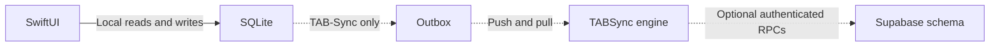

# TAB

**Private group expenses on your iPhone. No account, no server, no network.**

  

[Try it](#try-it) · [Screenshots](#screenshots) · [Architecture](#architecture) · [Documentation](#documentation)

TAB is a native iOS expense-sharing app whose local SQLite database is the source of truth. Groups, participants, expenses, balances and settlements work without a connection; the data never leaves the device: there are no accounts and no server. A sync engine (outbox, versioned operations, conflict review) exists in its own module and in a separate `TAB-Sync` build target, but it is not part of the app that ships; see [local-only](docs/architecture/local-only.md).

## What it includes

- **Offline-first groups:** create a group, add people and record expenses without waiting for a server.
- **Four ways to split:** equally, by shares, by percentage or by exact amounts, in integer minor units so splits always add up.
- **Exact balances:** net balance per person and suggested payments, always derived from the ledger.
- **Safe editing:** edit a shared expense while preserving an existing unequal split unless the amount or participants change.
- **Settle up and share:** PayPal, Revolut, Bizum and IBAN shortcuts (TAB never handles money); share a group as a file, QR code or link, or a who-owes-whom summary as text.
- **Backup, restore, delete:** one file with every group, and a way to erase everything.
- **Six languages:** English, Spanish, French, Italian, Portuguese and German.
- **No account, no network:** the shipping app has no sign-in, no analytics and no network code; it asks for no permission.
- **Sync (separate build):** the `TAB-Sync` target adds sync states and conflict review on top of the same local database.

## Try it

On a Mac with Xcode and [XcodeGen](https://github.com/yonaskolb/XcodeGen), run this from the repository root, then choose the TAB scheme and an iPhone simulator in Xcode. The `TAB` scheme is the local app and needs no credentials; the `TAB-Sync` scheme compiles the sync UI with the `SYNC` flag and reads `SUPABASE_URL` and `SUPABASE_ANON_KEY` from the build settings.

    xcodegen generate && open TAB.xcodeproj

The Xcode project is generated locally from [project.yml](project.yml) and is not committed. For a reproducible UI walkthrough, see [the demo guide](docs/release/demo.md); its screenshot script resets data in the selected simulator.

## Screenshots

The cover pairs the real app icon with crops of the screens below. Captured with the Debug UI walkthrough on an iPhone 17e simulator using seeded sample groups. To regenerate the raw walkthrough images, run [docs/release/export-screenshots.sh](docs/release/export-screenshots.sh) with a suitable simulator; the four PNGs below are smaller, curated copies for GitHub. Select an image to view it at full size. After updating the committed PNGs, rebuild the cover with Pillow:

    python3 docs/screenshots/build-showcase.py

| **Welcome** | **Groups and balances** |
| --- | --- |
|  |  |
| **Group detail** | **Edit an expense** |
|  |  |

## Architecture

The solid path is the shipping app (`TAB`, which links only `TABCore`). The dashed path exists only in `TAB-Sync`.

- **UI and storage:** local repositories provide immediate results, including while offline.
- **Balance engine and outbox:** balances are derived from expenses; changes are queued transactionally.
- **Sync boundary:** `TABSync` is a separate SwiftPM library that depends on `TABCore`, never the other way round. The local app does not link it, so no sync or network code ends up in the shipping binary.

## Design decisions

| Decision | Why | Cost |
| --- | --- | --- |
| **SQLite as source of truth instead of server-first requests** | Groups and balances respond offline. | Sync and recovery logic must be owned by the app. |
| **Integer minor units instead of floating point** | Splits and balances stay exact. | Currency formatting and parsing need explicit rules. |
| **Explicit split methods over free-form editing** | Shares, percentages and exact amounts are validated against the total, and remainders are deterministic. | Changing an amount or participant set replaces a custom split with an equal one, after a warning. |
| **Versioned outbox instead of last-write-wins silently** | A losing edit can be inspected and restored. | More state and conflict UI to maintain. |

## Known limitations

- The shipping app is local only; sync is not offered to users. No Supabase project is provisioned. Multi-device convergence is verified against an in-memory server, not a live deployment.
- The editor preserves a custom split only while the amount and participants stay the same; otherwise it recalculates an equal split, after a warning.
- One currency per group; payments, bank connections, currency conversion and receipt OCR are out of scope.
- `v1.0.0` is the portfolio source tag. The App Store release is 1.1.0 and has not been submitted yet: the physical-iPhone validation, localised screenshots and TestFlight are still open. The [release notes](docs/release/release-notes.md) list what was verified and what was not.

## Quality

- Swift package tests cover domain, persistence, split methods, balances, sharing, payment links and (in `TABSyncTests`) the sync engine. Run `swift test`; GitHub Actions runs it with a simulator build and the localisation check on every push ([ci.yml](.github/workflows/ci.yml)).
- UI walkthroughs exercise onboarding, offline expense entry and editing on an iPhone simulator, in English.
- The two-device sync scenario runs against an in-memory backend and belongs to the unshipped `TAB-Sync` build.
- Not yet done: a week of use on a physical iPhone ([checklist](docs/release/device-validation.md)).

## Documentation

| Document | Contents |
| --- | --- |
| [Product scope](docs/product/mvp.md) | Positioning, user flows and scope of 1.1. |
| [Privacy policy](docs/privacy.md) · [Support](docs/support.md) | Published with GitHub Pages and linked from Settings. |
| [App Store handoff](docs/release/app-store/README.md) | Listing text in six languages, privacy and review answers. |
| [Offline architecture](docs/architecture/offline-architecture.md) | Storage, sync and trade-offs. |
| [Data model](docs/architecture/data-model.md) | Users, expenses, splits and balances. |
| [Local only](docs/architecture/local-only.md) | What ships, what is behind `SYNC`, and how it is verified. |
| [Sync protocol](docs/architecture/sync-protocol.md) | Outbox, retries and convergence (`TABSync`). |
| [Conflict policy](docs/architecture/conflict-policy.md) | Resolution and restoration. |
| [Demo](docs/release/demo.md) · [Release notes](docs/release/release-notes.md) | Screenshots and validation boundaries. |
| [Device validation](docs/release/device-validation.md) | Checklist for the physical-iPhone gate. |

## Repository layout

    App/               SwiftUI screens, theme and Localizable.xcstrings
    Sources/TABCore/   Domain, SQLite repositories, balances
    Sources/TABSync/   Sync engine, auth and Supabase client (TAB-Sync build only)
    Tests/             Domain, persistence and sync tests
    scripts/           Repository checks (localisation catalog)
    UITests/           Simulator walkthroughs
    supabase/          Schema and RPCs (not deployed for this demo)
    docs/              Architecture decisions, demo and release evidence

## Distribution and license

No backend is deployed and the app is not on the App Store yet. Credentials are only used by the unshipped `TAB-Sync` build, supplied per build by a developer who configures their own backend. Licensed under [MIT](LICENSE).
