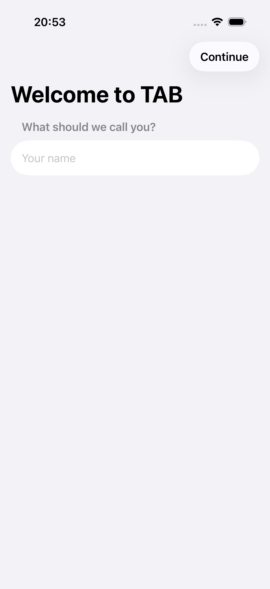
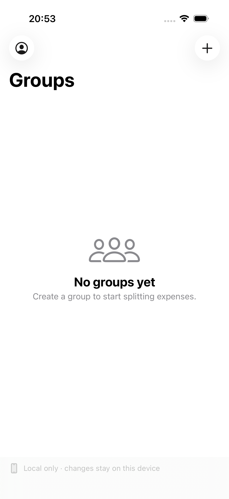
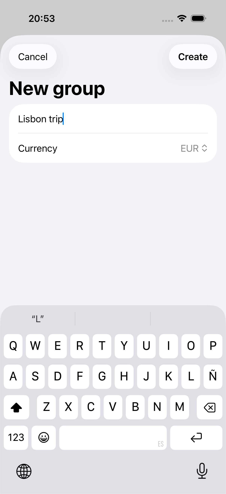
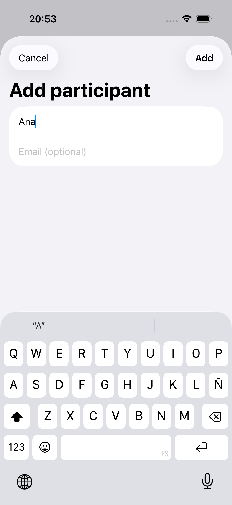
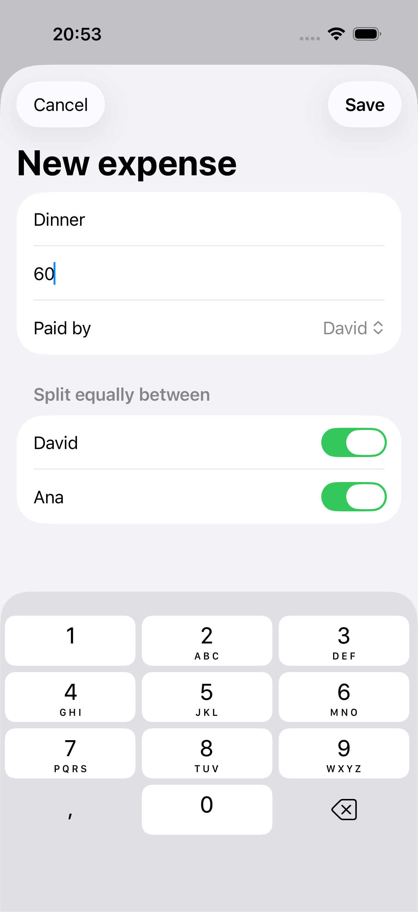
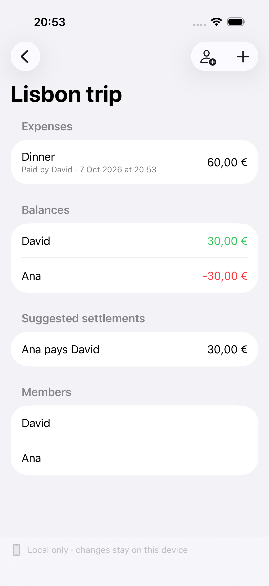

# Demo

> **TAB 1.1 is local only.** Part 1 is the app that ships. Part 2 belongs to the `TAB-Sync` build, which is not shipped; see [local-only](../architecture/local-only.md).

The acceptance scenario for the shipping app is: **install, enter a name, create a group and an expense with the network off, and see balances and a suggested payment.** Nothing in the app needs a connection, so this is also the whole product.

| Part | What it shows | Backend |
| --- | --- | --- |
| [The app](#1-the-app-offline) | The real UI creating a group and an expense | None: no network code |
| [Two devices, reconnecting](#2-two-devices-reconnecting) | The sync protocol delivering an expense to a second device (`TAB-Sync` only) | In-memory server, in a test |

## 1. The app, offline

The UI test `UITests/WalkthroughUITests.swift` drives the real app on a simulator through the flow below and attaches a screenshot at each step. It runs in English.

| Step | Screen |
| --- | --- |
| Enter a name |  |
| Empty list of groups |  |
| Create "Lisbon trip" |  |
| Add Ana |  |
| Add a 60,00 € dinner |  |
| The expense is listed at once and balances are derived |  |

The test also asserts that the local app shows no Account button and no sync status, and takes `07-groups-local`. The committed PNGs in `screenshots/` come from an earlier run and are regenerated by the script below; run it on a Mac before using them for the App Store (see [app-store](app-store/README.md)).

Run it, and regenerate the screenshots, with:

```sh
docs/release/export-screenshots.sh              # default simulator: iPhone 17 Pro
docs/release/export-screenshots.sh "iPhone 16"  # another simulator
```

The script needs Xcode and [XcodeGen](https://github.com/yonaskolb/XcodeGen). The test launches the app with `-resetData` (a `DEBUG`-only argument that drops the local database and current user) so every run starts clean. `-demoData` seeds a realistic "Lisbon trip" group instead.

## 2. Two devices, reconnecting (`TAB-Sync` only)

`OfflineToOnlineDemoTests.anExpenseCreatedOfflineReachesAnotherDeviceAfterReconnecting` is the scenario as one test:

```sh
swift test --filter OfflineToOnlineDemoTests
```

| # | What happens | What the test asserts |
| --- | --- | --- |
| 1 | The phone goes offline and David records a dinner | The expense is readable locally and its status is `pending` |
| 2 | The phone tries to sync | The outcome is `offline`, the server holds no expense, and the other device pulls nothing |
| 3 | The connection returns | The outcome is `completed`, the expense is `synced` and the server holds it |
| 4 | The tablet syncs | It has the expense, and its balances are equal to the phone's |

The same behaviour is covered in more depth by these tests (all in `Tests/TABSyncTests`):

- `SyncEngineTests.offlineWritesAreSentWhenTheConnectionReturns`: every queued operation is delivered, in order.
- `SyncEngineTests.anotherDevicePullsEverythingInDependencyOrder`: a new device rebuilds users, groups, members and
  expenses with their splits.
- `SyncResilienceTests.changesMadeOfflineOnTwoDevicesMergeWhenBothReconnect`: both devices change data offline and
  converge when they reconnect.

### What this does and does not prove

The "other device" is a second database and sync engine talking to `InMemoryServer`, a fake that implements the same
`RemoteBackend` protocol as the Supabase client. It proves that the **client protocol** (outbox, push, pull, retry,
convergence) behaves correctly. It does **not** prove that the Supabase project, its auth or its network layer work,
because none exists. Two physical devices syncing through a real server has not been demonstrated.
